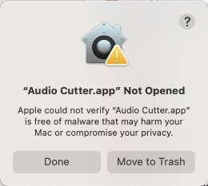
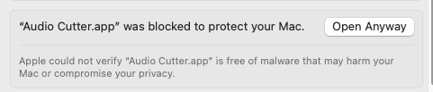
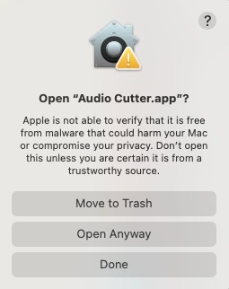
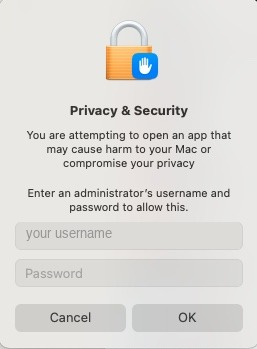

# Audio Cutter

Open an audio file, select the part you want, export it.

A free, open-source audio editor for macOS. Built with Claude Code.

If it helps you - great! I will add more features in the future, you don't have to credit anybody.

## Install

Requires macOS 14 or later on Apple Silicon.

Download the `.dmg` from [Releases](../../releases), open it, drag **Audio Cutter** to Applications.

### First launch

The app is not notarized by Apple, so macOS blocks the first launch.



1. Click **Done**.
2. Open **System Settings > Privacy & Security**, scroll to **Security**, click **Open Anyway**.



3. Click **Open Anyway** again.



4. Enter your administrator password, click **OK**.



This is only needed once. The **Open Anyway** button disappears about an hour after the warning; if it is missing, open the app again. On macOS 15 and later, right-click > Open no longer works.

To skip the warning, build from source (below), or run:

```bash
xattr -dr com.apple.quarantine "/Applications/Audio Cutter.app"
```

### MP3 support (optional)

```bash
brew install ffmpeg
```

Needed for MP3 export and lossless MP3 cutting. Everything else works without it.

## Features

- Opens MP3, WAV, FLAC, AIFF, M4A/AAC, CAF
- Drag to select, with audio scrubbing while you drag. Double-click selects all
- **Keep** (⌘K) removes everything outside the selection. **Delete** removes the selection
- Mark multiple regions (⌘M), then delete them all or export each as a separate file
- Export WAV, AIFF (24-bit), FLAC, M4A, MP3
- Lossless cutting for MP3/M4A when the audio is unedited. Cuts land on the nearest frame (about 26 ms)
- Normalize, fade in/out, silence, reverse, trim silence from both ends
- Playback from 0.25x to 4x (pitch changes with speed)
- Cuts snap to zero crossings (max 8 ms) with a 4 ms fade, to prevent clicks
- Stereo shown as separate L and R lanes
- Scroll wheel zooms at the pointer; the view follows the playhead

## Keyboard

| Key | Action |
|---|---|
| Space | play / pause |
| J / K / L | play backwards / pause / play forwards (press J or L again for 2x, 4x) |
| Delete | delete selection |
| ← → | move playhead 0.1 s (1 s with Shift) |
| Return | back to start |
| Esc | clear selection |
| ⌘O | open |
| ⌘K | keep selection |
| ⌘E | export |
| ⌘M | mark region |
| ⌘A | select all |
| ⌘Z | undo |
| ⌘0 | fit to window |

## Build from source

Requires macOS 14+ and Xcode or the Command Line Tools.

```bash
git clone https://github.com/sergiulupse/audio-cutter.git
cd audio-cutter && ./build.sh
```

Options: `debug`, `--no-run`, `--icon`, `--dmg`.

Tests:

```bash
./Tests/HeadlessCheck/run.sh
./Tests/TransportCheck/run.sh
```

## Known limits

- Undo history is capped at 1.5 GB, so long files get fewer undo steps
- Edits apply to both channels
- No auto-split on silence
- No noise reduction
- One file at a time
- macOS only

Details in [DESIGN-NOTES.md](DESIGN-NOTES.md).

## License

MIT. See [LICENSE](LICENSE). Bug reports welcome, see [CONTRIBUTING.md](CONTRIBUTING.md).
